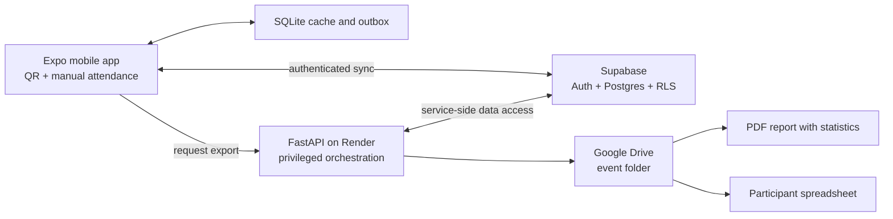

# icpep-scansync — Update report and architecture overview

Date: 2026-08-15
Scope: Refactoring of the `rn-attendance-scanner` mobile frontend, implementation of dedicated feature routes, audio feedback integration, scanner flow fixes, and UI enhancements.

---

## 1. What was done

### 1.1 Dedicated Feature Navigation & Pages
- **Dedicated Events Page (`/events`)**: Added `src/app/events.tsx` and `src/features/events/events-screen.tsx` with full event management, creation modal, and per-event year breakdown.
- **Dedicated History Page (`/history`)**: Added `src/app/history.tsx` and `src/features/attendance/history-screen.tsx` for full scan history filtering, editing, and record deletion.
- **Home Dashboard Navigation Buttons**: Replaced heavy inline lists on `HomeScreen` with interactive action cards for **Events** and **Attendance History** with live record counters and `router.push()` navigation.
- **Cleaned Home Layout**: Removed the overall year-level breakdown from the Home dashboard to keep the initial tab clean and focused on quick stats.

### 1.2 Dedicated Feature Directory Structure
Reorganized codebase into dedicated domain feature folders:
- **`src/features/scan/`**: Created dedicated folder containing `scanner-screen.tsx`, `scanner-overlay.tsx`, `scanner-verification-pill.tsx`, `scanner-manual-entry.tsx`, `qr-payload.ts`, and `qr-payload.test.ts`.
- **`src/features/events/`**: Contains `events-screen.tsx`, `events-section.tsx`, `event-repository.ts`, and event types.
- **`src/features/attendance/`**: Contains `history-screen.tsx`, `history-section.tsx`, `year-level-breakdown.tsx`, and `year-level.ts`.
- **`src/features/home/`**: Home dashboard-specific components (`home-screen.tsx`, `home-header.tsx`, `quick-stats.tsx`, `scanner-status-card.tsx`).

### 1.3 Scanner Enhancements & Audio Feedback
- **Audio Feedback (`expo-audio`)**: Installed `expo-audio` (~1.1.1) and integrated sound effects:
  - `assets/sounds/Success.mp3`: Plays automatically upon successful check-in.
  - `assets/sounds/Failed.mp3`: Plays on duplicate check-ins, unsupported QR codes, or save errors.
- **Scanner Re-triggering Fix**: Resolved camera frame loop bug by setting `scanLock.current = true;` immediately when a barcode is detected, locking the camera until attendance is processed.
- **Hands-Free Auto-Reset**: Configured an automatic 2-second reset timer after check-in, unlocking the scanner automatically for continuous scanning without needing a manual "Scan Next" button.
- **Cleaner Viewfinder UI**: Removed the static `Format: NAME` text from the bottom of the scanner screen.

### 1.4 Events Section UI Upgrade
- Modern card layout with vertical status indicator bars (Emerald green for `Active`, Slate gray for `Draft`).
- Metadata row formatted with icons (`calendar-outline` for date/time, `location-outline` for venue).
- Attendance capacity progress bar showing filled attendee ratio and percentage.
- Recent check-ins list with participant avatar initials circles, year level badges, and timestamps.

### 1.5 Apple-Inspired Custom Date & Time Pickers
- **Custom Calendar Date Picker (`src/components/date-picker-modal.tsx`)**:
  - Replaced native system pickers with an Apple-inspired minimal custom calendar modal.
  - **Fixed Card Dimensions (340x480px)**: Eliminates vertical layout jumps and screen resizing when switching between 28-day, 30-day, and 31-day months.
  - **42-Cell Uniform Grid Layout**: 6 rows x 7 days grid with padding cells for consistent month rendering.
  - **36x36px Circle Day Highlights**: Day selection indicator uses a perfect circle (`borderRadius: 18`) instead of square highlight boxes.
- **Custom Drum-Wheel Time Picker (`src/components/time-picker-modal.tsx`)**:
  - Custom drum-wheel scroll picker with snap-to-item mechanics.
  - Supports **12-hour clock (AM/PM)** formatting for event start times.
  - Fixed 340x350px card container with clean column dividers.

### 1.6 Event Status Categories & Interactive Management
- **Status Category Tabs**: Added **All**, **Active**, **Draft**, and **Ended** status filter tabs with live event count badges in `src/features/events/events-section.tsx`.
- **3-State Status Toggle Pill**: Card status pill cycles through `Active` ➔ `Draft` ➔ `Ended` ➔ `Active` on press.
- **Collapsed-by-Default Cards**: Event overview and check-in details are collapsed by default, expanding only when an event card is explicitly tapped.
- **Full Event Edit & Delete Modal**: Form modal for creating/editing events (with `Ended` option) and confirmation modal for idempotent local deletion and sync outbox queueing.

### 1.7 Attendance History Per-Event Dropdown, Manual Filters & Compact Rows
- **Per-Event View Dropdown Bar**: Replaced horizontal scroll chips with a clean Event Dropdown Selector Bar (`history-section.tsx`) showing selected event name, venue, record count, and dropdown sheet modal. Removed "All Events" option to strictly scope records per event.
- **Manual Filter Modal**: Integrated a dedicated Manual Filter Modal with explicit `Apply Filters` and `Reset All` buttons for Year Level (1–4) and Sync Status (`Synced`, `Review Needed`).
- **Flexible X Close Button**: Enhanced modal header with `flex: 1` title group and 36x36px close button, plus backdrop touch dismissal.
- **Ultra-Compact Item Rows**: Compacted participant record row boxes (`paddingVertical: 8`), `26x26px` avatar initials circles, streamlined typography, and `26px` min-height action pills.

### 1.8 Home Screen Management & History Sync Button
- Added a soft green **Sync** badge pill (`sync-outline` icon) right beside the **Management & History** title on the Home dashboard (`home-screen.tsx`).

---

## 2. Architecture overview

### 2.1 System context



### 2.2 Repository layout

```
icpep-scansync/
├── src/app/              Expo Router routes (thin route files)
│   ├── _layout.tsx       Root stack: (auth) + (tabs) + events + history
│   ├── (tabs)/           Home, Scan, Profile tab routes + tab layout
│   ├── events.tsx        Dedicated Events route
│   ├── history.tsx       Dedicated History route
│   └── (auth)/           Login route
├── src/components/       Reusable visual components (date-picker-modal, time-picker-modal, app-tabs)
├── src/constants/        theme.ts (light/dark) + palette.ts (UI palette)
├── src/features/         Feature modules
│   ├── scan/             Dedicated QR scanner UI, overlay, verification pill, QR parsing
│   ├── events/           Events screen, event list/creation section, repository
│   ├── attendance/       Attendance history screen, history list/edit modal, year-level logic
│   ├── home/             Integrated dashboard (header, stats, navigation cards)
│   ├── profile/          Profile screen
│   └── auth/             Login screen
├── src/hooks/            use-theme, use-color-scheme
├── src/lib/              SQLite, sync queue, Supabase client, env, UUIDs
├── src/types/            Shared style declarations
├── supabase/migrations/  Forward-only PostgreSQL migrations
├── backend/              FastAPI service boundary (Phase 5 stub)
└── docs/                 ARCHITECTURE.md, ARCHITECTURE_OVERVIEW.md, IMPLEMENTATION_PLAN.md
```

### 2.3 Route map

| Route | File | Purpose |
| --- | --- | --- |
| `/` | `src/app/(tabs)/index.tsx` | Home — dashboard, scanner status, stats, and navigation buttons |
| `/scan` | `src/app/(tabs)/scan.tsx` | Scan — full-bleed QR scanner camera UI |
| `/profile` | `src/app/(tabs)/profile.tsx` | Profile — scanner/device/preferences |
| `/events` | `src/app/events.tsx` | Dedicated Events page — event list, creation modal, and event detail |
| `/history` | `src/app/history.tsx` | Dedicated History page — full attendance history, filters, edit/delete modals |
| `/login` | `src/app/(auth)/login.tsx` | Mock login (placeholder for Phase 2 auth) |

### 2.4 Tech stack

- Expo SDK 54, React Native 0.81, React 19.1, TypeScript 5.9 (strict)
- `expo-audio` ~1.1.1 — audio playback for scanner feedback (added)
- `expo-router` v6, `expo-sqlite`, `expo-camera`, `expo-constants`, `expo-crypto`, `expo-dev-client`
- `expo-font`, `expo-image`, `expo-linking`, `expo-network`, `expo-splash-screen`
- `expo-status-bar`, `expo-symbols`, `expo-system-ui`, `expo-web-browser`
- `@expo/vector-icons` — icon set (added)
- `react-native-safe-area-context` ~5.6.0 — safe-area insets handling (added)
- `react-native-gesture-handler` ~2.28.0 — gesture recognizer foundation (added)
- `react-native-reanimated` ~4.1.1 — declarative animation engine (added)
- `react-native-worklets` 0.5.1 — JS worklet runtime for reanimated (added)
- `react-native-screens` ~4.16.0 — native navigation primitives (added)
- `react-native-web` ~0.21.0 — web renderer for Expo web support (added)
- `react-native-url-polyfill` ^4.0.0 — URL polyfill (added)
- `@supabase/supabase-js` ^2.112.3 — public Supabase client
- `vitest` ^4.1.10 tests, `eslint-config-expo` linting

---

## 3. Files changed

Added:
- `src/components/date-picker-modal.tsx` (Apple-style calendar picker)
- `src/components/time-picker-modal.tsx` (12-hour drum-wheel picker)
- `src/app/events.tsx`, `src/app/history.tsx`
- `src/app/(auth)/_layout.tsx`, `src/app/(auth)/login.tsx`
- `src/app/(tabs)/_layout.tsx`, `src/app/(tabs)/profile.tsx`
- `src/constants/palette.ts`
- `src/features/scan/{scanner-screen,scanner-overlay,scanner-verification-pill,scanner-manual-entry,qr-payload}.tsx`
- `src/features/events/{events-screen,events-section}.tsx`
- `src/features/attendance/{history-screen,history-section,year-level-breakdown,year-level}.tsx`
- `src/features/home/{home-screen,home-header,scanner-status-card,quick-stats}.tsx`
- `src/features/auth/login-screen.tsx`, `src/features/profile/profile-screen.tsx`
- `assets/sounds/{Success,Failed}.mp3`
- `UPDATE.md`

Modified:
- `src/features/events/events-section.tsx` (Status tabs, 3-state status toggle, collapsed overview, edit/delete modals, custom pickers)
- `src/features/events/event-repository.ts` / `event-repository.web.ts` (`updateEvent`, `toggleEventStatus`, `deleteEvent`, `updateAttendanceRecord`, `deleteAttendanceRecord`)
- `src/features/events/formatters.ts` (`formatEventStatus` mapping 'completed' -> 'Ended', 12-hour time formatting)
- `src/features/attendance/history-section.tsx` (Event Dropdown Bar, Manual Filter Modal, search bar, compact rows)
- `src/features/home/home-screen.tsx` (Sync button pill beside Management & History title)

---

## 4. Verification

| Check | Result |
| --- | --- |
| `npm run typecheck` | Pass (0 errors) |
| `npm run lint` | Pass (0 warnings) |
| `npm run test` | 3 files, 11 tests pass |
| `npx expo-doctor` | 18/18 checks pass |

---

## 5. Known gaps

- Migrated Home/Profile/Login/tab-bar use the prototype's static light palette; pre-existing theme-aware components still follow light/dark `useTheme`.
- Manual-entry sheet is a UI stub (no record written) until Phase 4 real manual lookup.
- Mock login is a Phase 2 placeholder until Supabase Auth.
- Changes are uncommitted and grouped logically for review.
