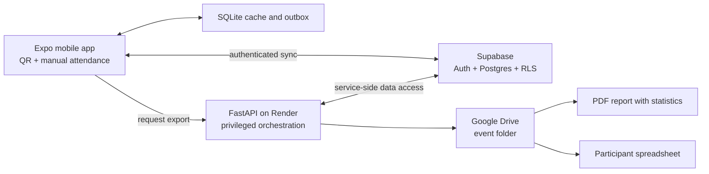

# Architecture

## System context

## Responsibilities

### Expo mobile app

- signs users in with Supabase Auth
- presents events available to the signed-in organizer or volunteer
- records QR or manual attendance immediately into SQLite
- uses a durable outbox and idempotent client IDs to synchronize when online
- shows history and sync status
- requests exports and observes export-job status

The mobile app is a public client. All access is constrained by Supabase RLS and backend JWT validation.

### Supabase

- stores profiles, organizations, memberships, invitations, events, participants, attendance, and export jobs
- authenticates admins and invited volunteers
- enforces organization, event, role, and expiry rules in RLS
- is authoritative after successful synchronization

SQLite is a working copy/outbox. Conflict policy for attendance is server-authoritative and idempotent: the same `client_record_id` may be replayed safely, while the first accepted check-in for an event/participant wins unless a later product decision introduces check-out or corrections.

### FastAPI backend

- validates Supabase access tokens and role/organization scope
- owns the Supabase service credential and Google credentials
- creates or resolves the Drive root/event folders
- renders a statistical PDF and participant spreadsheet from a consistent Supabase snapshot
- uploads artifacts to Drive and updates `export_jobs`
- retries idempotently using one Drive file reference per export job

### Google Drive

Drive is a document destination and sharing surface, not the primary database. An event folder contains generated artifacts; its file IDs are stored in Supabase so exports can be tracked and regenerated.

## Mobile data flow

1. QR scan or manual input is validated locally. Legacy school QR values are parsed as name, student ID, and program claims.
2. For a validated ten-digit school ID, the scanner derives year level from the ID entry-year prefix and the event's explicit academic reference year. Older cohorts are capped at level 4.
3. Opaque, malformed, or future-year references require operator confirmation until a participant roster can supply their classification.
4. The app writes the attendance record, derived or confirmed year level, and outbox operation in one SQLite transaction.
5. The UI confirms local capture without waiting for the network.
6. When connectivity and authentication are available, the sync worker replays pending operations.
7. Supabase accepts the idempotent record under RLS, or returns a categorized conflict.
8. The app marks the outbox entry synced or retryable.

## Current local vertical slice

- The superadmin dashboard reads event, attendance, and pending-sync statistics from local persistence.
- Event creation writes the event and its sync operation in one native SQLite transaction.
- Event creation stores an explicit academic reference year so historical classifications do not change with the device calendar.
- Active events are selectable in the QR scanner.
- The scanner accepts both `attendance://participant/<opaque-id>` payloads and legacy university `name<TAB>student-id<TAB>program` payloads.
- Legacy university QR fields are validated for shape, stored as identity claims, and queued for immediate synchronization. Operators can correct or delete an inaccurate check-in after the fact.
- Duplicate event check-ins are prevented by event and participant reference, and attendance plus its sync operation are written atomically.
- Overall and per-event statistics group attendance by the stored derived or operator-confirmed year level. Legacy records with no classification remain visible as “year not recorded.”
- Event detail and attendance history views can be filtered to one event without changing the underlying local records.
- Authorized history users can correct participant claims and year level or delete a check-in after explicit confirmation. Local statistics refresh after either mutation.
- Offline edits rewrite an existing unsynced insert/update payload. Offline deletion cancels an unsynced insert or queues a delete for a remotely existing record, avoiding impossible update-after-delete sequences.
- Android is the primary deployment target. iOS is supported for current LAN testing. Web uses browser storage for preview behavior and does not represent native offline durability.

## Security decisions

- Managed QR payloads should contain an opaque, revocable identifier or signed short-lived claim, not participant PII.
- Existing university ID QR codes contain unsigned PII and can be reproduced. The app extracts them only for compatibility, validates the payload shape, and never logs the raw payload. Records are synced as identity claims, and operators can correct or delete inaccurate check-ins manually.
- Volunteer access is both role-limited and time-limited. Expiry must be checked server-side/RLS, not just hidden in the app.
- Google OAuth refresh tokens and service-account material are encrypted hosting secrets.
- Export downloads should use controlled backend redirects or time-limited links rather than public Drive permissions by default.
- Logs and telemetry must omit participant PII, QR values, tokens, and raw report contents.

## Deployment shape

- Mobile: EAS Build/Submit when release work begins.
- Database/Auth: hosted Supabase project with checked-in migrations.
- API/workers: FastAPI on Render; a background job mechanism may be added when report generation exceeds request limits.
- Documents: a dedicated shared Drive or Shared Drive controlled by the organization.
